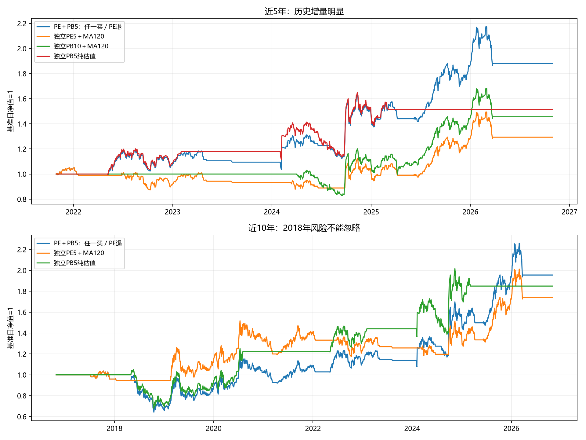
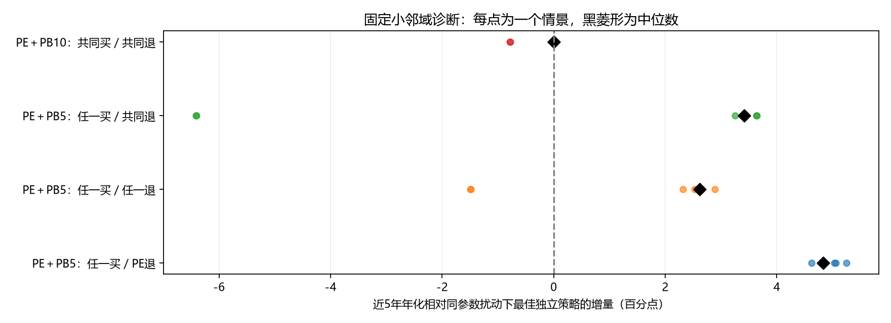

# 中证500 PE与PB固定信号组合研究

数据截至2026-10-30，研究日期2026-10-31。固定三套已有参数，只组合其买卖条件；未重新优化估值窗口、均线、阈值或资金比例，网站及生产代码未修改。

## 核心结论

**发现了明确的近年历史增量，但尚不能认定为跨周期稳定、可直接替换正式策略的优势。** 最值得新增前瞻验证的是“**PE或PB5纯估值任一满足买入，仍按PE规则退出**”：近5年年化13.47%、回撤15.87%，独立PE为5.28%／17.04%，独立PB5纯估值8.65%／19.68%。这是同标的、同费用、无杠杆下的完整账户差异，不是漏计空仓、增加资金或只统计成功交易造成。

该组合近3年年化19.77%，近10年6.93%；但近10年最大回撤38.08%，明显大于独立PE22.68%。2017—2020共同起点训练段年化仅0.54%，低于PE7.28%；2018年早买造成较大拖累。近年的收益和回撤改善不能推导为长期风险也改善。

只按训练段选出的结构是“PE与PB10共同买入、共同确认退出”，但它在本样本实际复现PB10独立策略，没有组合增量。不能看到另一个组合留出表现更好，就把它改称训练选择成功。最优近期组合属于**留出观察后的研究提名**，需要新的前瞻数据。

## 一、三个独立组件：全部参数冻结

|代号|固定独立策略|原始买入条件E|原始退出条件X|
|---|---|---|---|
|A|正式PE5年＋MA120〔60／30〕|PE5分位<60%且收盘>MA120|PE5分位≥30%且收盘≤MA120|
|B|PB10年＋MA120〔10／60〕|PB10分位<10%且收盘>MA120|PB10分位≥60%且收盘≤MA120|
|C|PB5年纯估值〔10／60〕|PB5分位<10%|PB5分位≥60%|

本轮使用此前主研究口径：PE实际字段ttmPe、PB字段pb，对应本机AkShare映射的等权估值，不混用整体法数值。A直接使用生产相同的历史分位计算；B、C使用此前冻结的月度PB分位。两者均额外滞后一个ETF交易日，按当时可见数据计算，不使用接口的全历史分位。

这里的PE／PB组合是**固定买卖谓词的布尔组合**，不是此前PE与PB分位50／50平均的新估值分数，也不是把资金分成两个独立投资账户。全账户最多一份中证500ETF持仓，两个买入条件同时出现不加倍买入或加杠杆。

## 二、持有、退出与冲突的明确定义

每个组合有自己的持仓状态，使用当日原始E／X条件组合；**不把两个独立策略已经运行过的持仓0／1直接求交集、并集**。因此退出后，只要条件重新允许，就可以再次进入，即使PB低估区间本身一直未结束。没有额外冷却期或新止损。

统一状态机：
1. 所需估值有效时，先检查组合退出X；X为真，退出或保持空仓。
2. X为假且空仓，组合买入E为真，才进入。
3. 其他情况保持原状态；估值缺失则暂停判断并保持，不用未来值补齐。
4. 信号下一交易日开盘执行。

**退出优先也是否决入场的条件**：若PB要求买入但PE要求退出，不会今天买、明天卖、后天又买。共同退出指**同一个收盘日**两个／三个X同时满足，不记忆上周曾经发生过的退出确认。

对每个PE／PB配对做八个固定结构：共同／任一买入分别配合PE退出、任一退出、共同退出，再加PE买入PB退出、PB买入PE退出；另补四个三者AND／OR方案，共20个预设结构。实际只有14条不同有效起点下的完整信号路径，等价结果不算多次独立验证。

| 组合 | 原始买入E | 原始退出X |
| --- | --- | --- |
| PE＋PB10：共同买／PE退 | EA ∧ EB | XA |
| PE＋PB10：任一买／PE退 | EA ∨ EB | XA |
| PE＋PB10：共同买／任一退 | EA ∧ EB | XA ∨ XB |
| PE＋PB10：任一买／任一退 | EA ∨ EB | XA ∨ XB |
| PE＋PB10：共同买／共同退 | EA ∧ EB | XA ∧ XB |
| PE＋PB10：任一买／共同退 | EA ∨ EB | XA ∧ XB |
| PE＋PB10：PE买／PB退 | EA | XB |
| PE＋PB10：PB买／PE退 | EB | XA |
| PE＋PB5：共同买／PE退 | EA ∧ EC | XA |
| PE＋PB5：任一买／PE退 | EA ∨ EC | XA |
| PE＋PB5：共同买／任一退 | EA ∧ EC | XA ∨ XC |
| PE＋PB5：任一买／任一退 | EA ∨ EC | XA ∨ XC |
| PE＋PB5：共同买／共同退 | EA ∧ EC | XA ∧ XC |
| PE＋PB5：任一买／共同退 | EA ∨ EC | XA ∧ XC |
| PE＋PB5：PE买／PB退 | EA | XC |
| PE＋PB5：PB买／PE退 | EC | XA |
| 三策略：共同买／任一退 | EA ∧ EB ∧ EC | XA ∨ XB ∨ XC |
| 三策略：任一买／任一退 | EA ∨ EB ∨ EC | XA ∨ XB ∨ XC |
| 三策略：共同买／共同退 | EA ∧ EB ∧ EC | XA ∧ XB ∧ XC |
| 三策略：任一买／共同退 | EA ∨ EB ∨ EC | XA ∧ XB ∧ XC |

上表买入实际还必须满足“组合X为假”。符号∧=同时满足，∨=任一满足。哪个原始条件被组合采用由结构决定；没有改阈值。例如近期最佳组合使用C的买入<10%，不采用C的卖出≥60%，由A退出接管，这不是把PB退出阈值改成另一个数。

### 最值得前瞻验证的候选，完整公式

- 买入：`[(PE5分位<60% 且 收盘>MA120) 或 PB5分位<10%]`，**同时不满足**`[PE5分位≥30% 且 收盘≤MA120]`。
- 持有：买入后保持，直到下述退出。
- 退出：`PE5分位≥30% 且 收盘≤MA120`；下一交易日开盘执行。
- 空仓：退出后可在上述买入条件重新成立时再进入；没有PB5低估信号时，仍保留原PE策略的入场机会。

其所需活动阈值只有PE买入60、PE卖出30、PB5买入10；PB5卖出60在这个结构中未被采用，因此稳定性检验不把改变这一无效参数当作额外成功样本。

## 三、执行、区间与公平对照

固定10万元起始资金，100份整数手，信号次日开盘，单边0.1%滑点、佣金万一且最低5元；无入金、无10%资金限制、空仓现金收益0。全部交易、亏损和空仓计入，期末标记收盘市值、不强制清仓。收益已扣实际费用，不再二次扣除。

沿用同一条连续账户状态切片，近1／3／5／10年基准收盘日依次为2025-10-30、2023-10-30、2021-10-29、2016-10-28，均结束于2026-10-30。回溯区间不重启账户，区间最大回撤从基准净值起算，年化按365.25／实际日历天数计算。

PE＋PB5从2014-03-31具备有效历史；所有含PB10的组合从2017-01-04才有效，近10年标不足，不用无效期现金凑满。独立A、C原账户自2014年运行，B自2017年运行。为测增量，另把各独立策略从对应组合的**同一有效起点、同一10万元本金**重放：P10、三者组合对照从2017年起，P5对照从2014年起。后文增量表采用这些匹配对照，原独立表现也保留。

成交次数是买、卖分别计单，跨区间带入的持仓可只有退出一单；不能除2当作新完整交易。持仓占比按收盘持有份额的交易日比例统计，另存平均资金暴露。

来源复用此前冻结OHLC、PE缓存和PB特征文件，未下载新数据。估值历史可能被供应商修订、月度快照不等于真实日度估值全记录、前复权价格与整数份模型不是实际现金分红逐笔账本，仍是可执行性与因果解释限制。

## 四、全部固定组合与独立策略：横向表现

### 年化收益率（%）

| 固定组合 | 近1年 | 近3年 | 近5年 | 近10年 |
| --- | --- | --- | --- | --- |
| 独立PE5＋MA120 | 2.00 | 11.48 | 5.28 | 5.70 |
| 独立PB10＋MA120 | 2.00 | 13.35 | 7.81 | 历史不足 |
| 独立PB5纯估值 | 0.00 | 8.68 | 8.65 | 6.34 |
| PE＋PB10：共同买／PE退 | 0.00 | 2.35 | 1.40 | 历史不足 |
| PE＋PB10：任一买／PE退 | 2.00 | 11.48 | 5.28 | 历史不足 |
| PE＋PB10：共同买／任一退 | 0.00 | 2.35 | 1.40 | 历史不足 |
| PE＋PB10：任一买／任一退 | 2.00 | 11.48 | 5.28 | 历史不足 |
| PE＋PB10：共同买／共同退 | 2.00 | 13.35 | 7.81 | 历史不足 |
| PE＋PB10：任一买／共同退 | 1.99 | 12.21 | 2.69 | 历史不足 |
| PE＋PB10：PE买／PB退 | 1.99 | 12.21 | 2.69 | 历史不足 |
| PE＋PB10：PB买／PE退 | 0.00 | 2.35 | 1.40 | 历史不足 |
| PE＋PB5：共同买／PE退 | 0.00 | 2.35 | 1.40 | 2.52 |
| PE＋PB5：任一买／PE退 | 2.00 | 19.77 | 13.47 | 6.93 |
| PE＋PB5：共同买／任一退 | 0.00 | 3.71 | 2.21 | 2.92 |
| PE＋PB5：任一买／任一退 | 0.00 | 11.38 | 11.29 | 6.19 |
| PE＋PB5：共同买／共同退 | 0.00 | 1.94 | 1.16 | 4.72 |
| PE＋PB5：任一买／共同退 | 2.00 | 18.00 | 12.06 | 7.10 |
| PE＋PB5：PE买／PB退 | 0.00 | 3.96 | 3.44 | 3.15 |
| PE＋PB5：PB买／PE退 | 0.00 | 9.57 | 8.19 | 3.19 |
| 三策略：共同买／任一退 | 0.00 | 3.71 | 2.21 | 历史不足 |
| 三策略：任一买／任一退 | 0.00 | 11.38 | 11.30 | 历史不足 |
| 三策略：共同买／共同退 | 2.00 | 13.35 | 7.81 | 历史不足 |
| 三策略：任一买／共同退 | 1.99 | 12.21 | 2.69 | 历史不足 |

### 最大回撤（%）

| 固定组合 | 近1年 | 近3年 | 近5年 | 近10年 |
| --- | --- | --- | --- | --- |
| 独立PE5＋MA120 | 14.25 | 15.87 | 17.04 | 22.68 |
| 独立PB10＋MA120 | 14.25 | 19.64 | 19.64 | 历史不足 |
| 独立PB5纯估值 | 0.00 | 19.68 | 19.68 | 35.52 |
| PE＋PB10：共同买／PE退 | 0.00 | 15.85 | 15.85 | 历史不足 |
| PE＋PB10：任一买／PE退 | 14.24 | 15.87 | 17.04 | 历史不足 |
| PE＋PB10：共同买／任一退 | 0.00 | 15.85 | 15.85 | 历史不足 |
| PE＋PB10：任一买／任一退 | 14.24 | 15.87 | 17.04 | 历史不足 |
| PE＋PB10：共同买／共同退 | 14.25 | 19.64 | 19.64 | 历史不足 |
| PE＋PB10：任一买／共同退 | 14.21 | 22.75 | 39.25 | 历史不足 |
| PE＋PB10：PE买／PB退 | 14.21 | 22.75 | 39.25 | 历史不足 |
| PE＋PB10：PB买／PE退 | 0.00 | 15.85 | 15.85 | 历史不足 |
| PE＋PB5：共同买／PE退 | 0.00 | 15.85 | 15.85 | 22.69 |
| PE＋PB5：任一买／PE退 | 14.26 | 15.87 | 15.87 | 38.08 |
| PE＋PB5：共同买／任一退 | 0.00 | 15.85 | 15.85 | 22.69 |
| PE＋PB5：任一买／任一退 | 0.00 | 15.86 | 15.86 | 38.10 |
| PE＋PB5：共同买／共同退 | 0.00 | 19.64 | 19.64 | 23.59 |
| PE＋PB5：任一买／共同退 | 14.25 | 19.68 | 19.68 | 41.75 |
| PE＋PB5：PE买／PB退 | 0.00 | 19.66 | 19.66 | 41.74 |
| PE＋PB5：PB买／PE退 | 0.00 | 15.85 | 15.85 | 35.52 |
| 三策略：共同买／任一退 | 0.00 | 15.85 | 15.85 | 历史不足 |
| 三策略：任一买／任一退 | 0.00 | 15.86 | 15.86 | 历史不足 |
| 三策略：共同买／共同退 | 14.25 | 19.64 | 19.64 | 历史不足 |
| 三策略：任一买／共同退 | 14.21 | 22.75 | 39.25 | 历史不足 |

### 实际成交单数

| 固定组合 | 近1年 | 近3年 | 近5年 | 近10年 |
| --- | --- | --- | --- | --- |
| 独立PE5＋MA120 | 1.00 | 10.00 | 21.00 | 54.00 |
| 独立PB10＋MA120 | 1.00 | 2.00 | 2.00 | 历史不足 |
| 独立PB5纯估值 | 0.00 | 2.00 | 4.00 | 6.00 |
| PE＋PB10：共同买／PE退 | 0.00 | 6.00 | 6.00 | 历史不足 |
| PE＋PB10：任一买／PE退 | 1.00 | 10.00 | 21.00 | 历史不足 |
| PE＋PB10：共同买／任一退 | 0.00 | 6.00 | 6.00 | 历史不足 |
| PE＋PB10：任一买／任一退 | 1.00 | 10.00 | 21.00 | 历史不足 |
| PE＋PB10：共同买／共同退 | 1.00 | 2.00 | 2.00 | 历史不足 |
| PE＋PB10：任一买／共同退 | 1.00 | 1.00 | 1.00 | 历史不足 |
| PE＋PB10：PE买／PB退 | 1.00 | 1.00 | 1.00 | 历史不足 |
| PE＋PB10：PB买／PE退 | 0.00 | 6.00 | 6.00 | 历史不足 |
| PE＋PB5：共同买／PE退 | 0.00 | 6.00 | 6.00 | 8.00 |
| PE＋PB5：任一买／PE退 | 1.00 | 10.00 | 21.00 | 54.00 |
| PE＋PB5：共同买／任一退 | 0.00 | 6.00 | 6.00 | 8.00 |
| PE＋PB5：任一买／任一退 | 0.00 | 10.00 | 13.00 | 42.00 |
| PE＋PB5：共同买／共同退 | 0.00 | 2.00 | 2.00 | 4.00 |
| PE＋PB5：任一买／共同退 | 1.00 | 4.00 | 15.00 | 24.00 |
| PE＋PB5：PE买／PB退 | 0.00 | 4.00 | 7.00 | 14.00 |
| PE＋PB5：PB买／PE退 | 0.00 | 6.00 | 8.00 | 10.00 |
| 三策略：共同买／任一退 | 0.00 | 6.00 | 6.00 | 历史不足 |
| 三策略：任一买／任一退 | 0.00 | 10.00 | 13.00 | 历史不足 |
| 三策略：共同买／共同退 | 1.00 | 2.00 | 2.00 | 历史不足 |
| 三策略：任一买／共同退 | 1.00 | 1.00 | 1.00 | 历史不足 |

### 持仓交易日占比（%）

| 固定组合 | 近1年 | 近3年 | 近5年 | 近10年 |
| --- | --- | --- | --- | --- |
| 独立PE5＋MA120 | 38.84 | 51.17 | 52.15 | 53.93 |
| 独立PB10＋MA120 | 38.84 | 65.47 | 39.27 | 历史不足 |
| 独立PB5纯估值 | 0.00 | 35.21 | 36.06 | 40.63 |
| PE＋PB10：共同买／PE退 | 0.00 | 22.97 | 13.78 | 历史不足 |
| PE＋PB10：任一买／PE退 | 38.84 | 51.17 | 52.15 | 历史不足 |
| PE＋PB10：共同买／任一退 | 0.00 | 22.97 | 13.78 | 历史不足 |
| PE＋PB10：任一买／任一退 | 38.84 | 51.17 | 52.15 | 历史不足 |
| PE＋PB10：共同买／共同退 | 38.84 | 65.47 | 39.27 | 历史不足 |
| PE＋PB10：任一买／共同退 | 38.84 | 79.64 | 87.79 | 历史不足 |
| PE＋PB10：PE买／PB退 | 38.84 | 79.64 | 87.79 | 历史不足 |
| PE＋PB10：PB买／PE退 | 0.00 | 22.97 | 13.78 | 历史不足 |
| PE＋PB5：共同买／PE退 | 0.00 | 22.97 | 13.78 | 17.79 |
| PE＋PB5：任一买／PE退 | 38.84 | 59.28 | 59.90 | 65.66 |
| PE＋PB5：共同买／任一退 | 0.00 | 19.81 | 11.88 | 16.84 |
| PE＋PB5：任一买／任一退 | 0.00 | 32.05 | 37.95 | 48.13 |
| PE＋PB5：共同买／共同退 | 0.00 | 33.43 | 20.05 | 29.81 |
| PE＋PB5：任一买／共同退 | 38.84 | 64.92 | 66.50 | 75.17 |
| PE＋PB5：PE买／PB退 | 0.00 | 34.80 | 36.72 | 53.73 |
| PE＋PB5：PB买／PE退 | 0.00 | 33.15 | 39.60 | 38.53 |
| 三策略：共同买／任一退 | 0.00 | 19.81 | 11.88 | 历史不足 |
| 三策略：任一买／任一退 | 0.00 | 32.05 | 37.95 | 历史不足 |
| 三策略：共同买／共同退 | 38.84 | 65.47 | 39.27 | 历史不足 |
| 三策略：任一买／共同退 | 38.84 | 79.64 | 87.79 | 历史不足 |

所有累计收益、Sharpe（无风险0）、Calmar、佣金和区间交易数也已保存于period_metrics.csv，不因本报告主要展示年化而省略账户数据。

## 五、收益优先、回撤其次：近5年完整诊断排序

| 组合 | 年化% | 最大回撤% | 成交单数 | 较同起点PE年化差pp | 较同起点最佳PB年化差pp |
| --- | --- | --- | --- | --- | --- |
| PE＋PB5：任一买／PE退 | 13.47 | 15.87 | 21.00 | 8.19 | 4.82 |
| PE＋PB5：任一买／共同退 | 12.06 | 19.68 | 15.00 | 6.77 | 3.41 |
| 三策略：任一买／任一退 | 11.30 | 15.86 | 13.00 | 6.02 | 2.65 |
| PE＋PB5：任一买／任一退 | 11.29 | 15.86 | 13.00 | 6.01 | 2.64 |
| PE＋PB5：PB买／PE退 | 8.19 | 15.85 | 8.00 | 2.91 | -0.46 |
| PE＋PB10：共同买／共同退 | 7.81 | 19.64 | 2.00 | 2.53 | 0.00 |
| 三策略：共同买／共同退 | 7.81 | 19.64 | 2.00 | 2.53 | -0.84 |
| PE＋PB10：任一买／PE退 | 5.28 | 17.04 | 21.00 | 0.00 | -2.53 |
| PE＋PB10：任一买／任一退 | 5.28 | 17.04 | 21.00 | 0.00 | -2.53 |
| PE＋PB5：PE买／PB退 | 3.44 | 19.66 | 7.00 | -1.85 | -5.21 |
| PE＋PB10：任一买／共同退 | 2.69 | 39.25 | 1.00 | -2.59 | -5.12 |
| PE＋PB10：PE买／PB退 | 2.69 | 39.25 | 1.00 | -2.59 | -5.12 |
| 三策略：任一买／共同退 | 2.69 | 39.25 | 1.00 | -2.59 | -5.95 |
| PE＋PB5：共同买／任一退 | 2.21 | 15.85 | 6.00 | -3.07 | -6.44 |
| 三策略：共同买／任一退 | 2.21 | 15.85 | 6.00 | -3.07 | -6.44 |
| PE＋PB10：共同买／PE退 | 1.40 | 15.85 | 6.00 | -3.88 | -6.40 |
| PE＋PB10：共同买／任一退 | 1.40 | 15.85 | 6.00 | -3.88 | -6.40 |
| PE＋PB10：PB买／PE退 | 1.40 | 15.85 | 6.00 | -3.88 | -6.40 |
| PE＋PB5：共同买／PE退 | 1.40 | 15.85 | 6.00 | -3.88 | -7.24 |
| PE＋PB5：共同买／共同退 | 1.16 | 19.64 | 2.00 | -4.12 | -7.48 |

这是结果诊断排序，不用于事后重新选择训练冠军。近期第一名“PE＋PB5任一买／PE退”近5年较PE增加约8.19个年化百分点，较PB5纯估值增加4.82个百分点；回撤分别减少约1.17与3.81个百分点。交易单数与PE同为21，持仓时间从52.15%增至59.90%，收益差不是简单增加杠杆或免费交易造成，但其中包含更多时段承担股票风险，并非市场中性Alpha测量。

次优“PE＋PB5任一买／共同退”近5年年化12.06%、回撤19.68%，近10年年化7.10%、回撤41.75%；它更长时间持有，但风险更高，不优先于较简单的PE退出方案。

“任一买／任一退”近5年11.29%、回撤15.86%，也有较好历史表现，但近3年11.38%并未超过独立PE11.48%，近1年为0；不同区间并非全面胜出。

## 六、PB10组合为何没有显示真正增量

在本样本2017年以来，PB10原始买入为真的138个信号日，PE买入都已经为真；PB10退出为真的106日，PE退出也已为真。因此共同买入实际等于PB10买入，共同确认退出实际等于PB10退出，“共同买／共同退”完全复现独立PB10，而非组合发现新机会。

同样，“任一买／PE退”在PE＋PB10中复现PE；“任一买／任一退”也近似同一条路径。三者OR中加入PB10没有明显新信息，少量收益差主要来自起始本金、整数份和费用路径差异，应使用匹配起点对照而不是称为增量。

| 配对 | 有效信号日 | PE买入日 | PB买入日 | 共同买入日 | 仅PB买入日 | PE退出日 | PB退出日 | 共同退出日 | 仅PB退出日 |
| --- | --- | --- | --- | --- | --- | --- | --- | --- | --- |
| P10 | 2384 | 869 | 138 | 138 | 0 | 565 | 106 | 106 | 0 |
| P5 | 3059 | 955 | 360 | 48 | 312 | 822 | 1220 | 407 | 813 |

这些是条件满足的天数，不是独立买入事件或交易样本数。PB5纯估值在PE没有买入条件时另有312个信号日，但在真实空仓状态下最终只形成下述四段PB单独驱动的提前入场。完整路径等价见equivalent_strategy_paths.csv和common_signal_equivalence.csv。

## 七、近年增量来自哪里：四段新增早买全部列出

| PB提前买入 | PE规则退出 | 该笔净收益% | 组合该段账户收益% | PE同段账户收益% | PB同段账户收益% | 较PE增量pp |
| --- | --- | --- | --- | --- | --- | --- |
| 2018-05-03 | 2020-03-17 | -7.69 | -7.67 | 19.58 | -8.55 | -27.25 |
| 2022-05-06 | 2023-04-26 | 12.73 | 12.71 | -3.88 | 17.95 | 16.59 |
| 2024-02-02 | 2024-06-07 | 13.78 | 13.78 | -3.26 | 12.84 | 17.04 |
| 2024-08-02 | 2025-04-07 | 17.53 | 17.53 | 11.48 | 21.47 | 6.05 |

这张表的账户收益在同一段起止收盘归一，PE或PB独立账户在其中可能稍后才买、也可能持续持有；不是删除未来坏交易的可执行新规则。四段互不重叠，但仍只有四个事件，不足以作稳定预测概率估计。

- **2018-05-03至2020-03-17**：组合提前买后整笔−7.69%，同段PE账户+19.58%，提前买相对等待PE亏损约27.25个百分点，是长周期风险恶化的重要来源。
- **2022-05-06至2023-04-26**：组合账户+12.71%，同段PE−3.88%，提前买增量约16.59个百分点；当时较早进入低位，优于等PE后来的趋势买入。
- **2024-02-02至2024-06-07**：组合+13.78%，同段PE−3.26%，增量约17.04个百分点；PB捕获趋势确认前的反弹，随后PE退出避免继续全程持有。
- **2024-08-02至2025-04-07**：组合此前已按PE退出，PB仍便宜时允许再次进入；组合+17.53%，同段PE+11.48%，增量约6.05个百分点。

组合并不要求PB低估信号先消失再重新出现；其自己的持仓状态决定是否可以买。因此2024年8月这次是PE退出后的PB重新许可，不是PB独立策略新增的一笔交易。2025年后PB单独策略已空仓，组合又能保留PE的后续趋势机会，这也解释其超过纯PB的总账户收益。

### 年度收益：同时展示坏年份

| 年份 | 任一买／PE退% | 独立PE% | 独立PB5% |
| --- | --- | --- | --- |
| 2014 | 37.89 | 37.89 | 0.00 |
| 2015 | 58.05 | 58.05 | 0.00 |
| 2016 | 0.00 | 0.00 | 0.00 |
| 2017 | -4.06 | -4.06 | 0.00 |
| 2018 | -30.45 | -1.34 | -29.48 |
| 2019 | 31.25 | 19.84 | 31.21 |
| 2020 | 16.64 | 16.68 | 32.02 |
| 2021 | 6.68 | 6.67 | 0.00 |
| 2022 | 2.05 | -12.97 | 8.18 |
| 2023 | 2.30 | 2.30 | 9.03 |
| 2024 | 34.19 | 8.23 | 25.78 |
| 2025 | 27.11 | 27.08 | 2.05 |
| 2026 | 0.74 | 0.74 | 0.00 |

2018年组合−30.45%，独立PE仅−1.34%；2022年组合+2.05%，PE−12.97%；2024年组合+34.19%，PE+8.23%；2025年组合与PE都约+27.1%，PB单独约+2.05%。近期增益来源清楚，但改善没有覆盖所有历史市场环境。

年度表的2014年从有效起点开始、2026年截至10月30日，均是各段累计收益，不是完整年度预测。

## 八、训练选择与回顾性样本外：必须分开

组合结构训练比较使用2017-01-04至2020-12-31共同起点10万元账户；每套所需估值此时都已有效，阈值固定。仅按训练年化优先、回撤其次、较少组件和固定名称打破平局，先将结构选择写入文件并哈希冻结，再运行留出账户。

| 结构/独立策略 | 共同起点训练年化% | 训练最大回撤% | 成交单数 |
| --- | --- | --- | --- |
| PE＋PB10：共同买／共同退 | 10.76 | 22.69 | 1 |
| PE＋PB5：任一买／PE退 | 0.54 | 38.02 | 22 |
| PE＋PB5：任一买／任一退 | 1.84 | 38.02 | 24 |
| PE＋PB5：任一买／共同退 | 1.95 | 41.69 | 1 |
| 独立PE5＋MA120 | 7.28 | 22.69 | 22 |
| 独立PB10＋MA120 | 10.76 | 22.69 | 1 |
| 独立PB5纯估值 | 5.15 | 35.52 | 2 |

训练选中的是“PE＋PB10共同买／共同退”，其10.76%年化、1次成交也与PB10单独相同；没有识别出额外组合收益。近期第一名“PE＋PB5任一买／PE退”训练年化0.54%、回撤38.02%，当时不会被收益优先的训练流程选出。

PE＋PB5共同买／共同退、三者共同买／共同退在训练段也同为10.76%、只有一次买入，最终按预定组件数和名称打破平局。训练期无法充分区分这些退出规则的效果，确定性选中PB10不代表已经证明它优于其他同分结构。

### 2021年以来及非重叠阶段

| 方案 | 阶段 | 年化% | 最大回撤% | 成交单数 | 持仓交易日% |
| --- | --- | --- | --- | --- | --- |
| PE＋PB10：共同买／共同退 | holdout | 6.59 | 21.28 | 3.00 | 35.18 |
| PE＋PB10：共同买／共同退 | stage2021_22 | -0.21 | 4.91 | 1.00 | 4.12 |
| PE＋PB10：共同买／共同退 | stage2023_24 | 3.92 | 19.64 | 1.00 | 37.81 |
| PE＋PB10：共同买／共同退 | stage2025_26 | 17.76 | 14.28 | 1.00 | 66.44 |
| PE＋PB5：任一买／PE退 | holdout | 11.78 | 15.87 | 32.00 | 63.12 |
| PE＋PB5：任一买／PE退 | stage2021_22 | 4.35 | 13.88 | 17.00 | 78.56 |
| PE＋PB5：任一买／PE退 | stage2023_24 | 17.13 | 14.30 | 10.00 | 53.51 |
| PE＋PB5：任一买／PE退 | stage2025_26 | 14.48 | 14.26 | 5.00 | 56.69 |
| PE＋PB5：任一买／任一退 | holdout | 9.47 | 15.86 | 18.00 | 35.96 |
| PE＋PB5：任一买／任一退 | stage2021_22 | 6.08 | 13.88 | 7.00 | 52.99 |
| PE＋PB5：任一买／任一退 | stage2023_24 | 20.89 | 14.29 | 6.00 | 40.91 |
| PE＋PB5：任一买／任一退 | stage2025_26 | 1.62 | 6.38 | 5.00 | 11.79 |
| PE＋PB5：任一买／共同退 | holdout | 11.02 | 19.68 | 23.00 | 69.22 |
| PE＋PB5：任一买／共同退 | stage2021_22 | 5.56 | 13.95 | 14.00 | 79.79 |
| PE＋PB5：任一买／共同退 | stage2023_24 | 12.40 | 19.68 | 6.00 | 69.42 |
| PE＋PB5：任一买／共同退 | stage2025_26 | 15.73 | 14.25 | 3.00 | 57.37 |
| 独立PE5＋MA120 | holdout | 4.82 | 20.09 | 32.00 | 56.45 |
| 独立PE5＋MA120 | stage2021_22 | -3.66 | 20.09 | 17.00 | 71.34 |
| 独立PE5＋MA120 | stage2023_24 | 5.21 | 13.02 | 10.00 | 41.32 |
| 独立PE5＋MA120 | stage2025_26 | 14.46 | 14.25 | 5.00 | 56.69 |
| 独立PB10＋MA120 | holdout | 6.59 | 21.28 | 3.00 | 35.18 |
| 独立PB10＋MA120 | stage2021_22 | -0.21 | 4.91 | 1.00 | 4.12 |
| 独立PB10＋MA120 | stage2023_24 | 3.92 | 19.64 | 1.00 | 37.81 |
| 独立PB10＋MA120 | stage2025_26 | 17.76 | 14.28 | 1.00 | 66.44 |
| 独立PB5纯估值 | holdout | 7.37 | 19.68 | 4.00 | 30.99 |
| 独立PB5纯估值 | stage2021_22 | 4.02 | 13.88 | 1.00 | 33.81 |
| 独立PB5纯估值 | stage2023_24 | 17.07 | 19.68 | 2.00 | 48.76 |
| 独立PB5纯估值 | stage2025_26 | 1.11 | 6.39 | 1.00 | 8.39 |

holdout基准为2020-12-31收盘，截至2026-10-30，组合任一买／PE退年化11.78%、回撤15.87%，对照PE4.82%／20.09%、PB5 7.37%／19.68%。三个阶段分别为2021—2022、2023—2024、2025—2026年截止日，净值边界连续，无重置。

**不能把这叫作训练选择成功。** 输入的三个候选此前已经由多轮同一历史研究提名，新组合也有20种结构比较；即使本轮先冻结训练结构，仍不能消除既有候选和已知行情带来的选择偏差。所有留出段已被看过，只能称为回顾性样本外，重叠的近1／3／5／10年不构成独立验证。

近期第一名是留出结果后的研究提名；新前瞻时间段尚不存在于本轮数据。其近3／5年及2021年后确有完整账户历史增量，不等于已经证明未来可重复。

## 九、参数稳定性：不重新选中心

只扰动每个结构实际使用的阈值：各自±5个百分点单变量变化，并加两组所有活动阈值一起±5。没有扫描全部高维参数组合或挑最好邻点。每个邻点还重算相同扰动参数下的独立策略，对照其最佳者，防止把单指标参数变好误归因于组合结构。

| 结构 | 扰动情景数 | 不同信号路径数 | 近5年中位年化% | 最低年化% | 最高年化% | 最差回撤% | 优于扰动独立策略情景数 |
| --- | --- | --- | --- | --- | --- | --- | --- |
| PE＋PB10：共同买／共同退 | 10 | 5 | 7.81 | 4.50 | 8.90 | 32.09 | 0 |
| PE＋PB10：共同买／PE退 | 8 | 7 | 1.40 | 0.35 | 2.19 | 15.85 | 0 |
| PE＋PB10：共同买／任一退 | 10 | 7 | 1.40 | 0.35 | 2.19 | 15.85 | 0 |
| PE＋PB10：PE买／PB退 | 6 | 3 | 2.70 | 2.69 | 4.27 | 39.42 | 0 |
| PE＋PB10：PB买／PE退 | 6 | 6 | 0.90 | 0.35 | 2.19 | 15.84 | 0 |
| PE＋PB10：任一买／共同退 | 10 | 3 | 2.69 | 2.69 | 4.27 | 39.42 | 0 |
| PE＋PB10：任一买／PE退 | 8 | 5 | 5.28 | 4.19 | 5.48 | 19.78 | 0 |
| PE＋PB10：任一买／任一退 | 10 | 5 | 5.28 | 4.19 | 5.48 | 19.78 | 0 |
| PE＋PB5：共同买／共同退 | 10 | 4 | 1.16 | 0.96 | 7.80 | 19.64 | 0 |
| PE＋PB5：共同买／PE退 | 8 | 5 | 1.30 | 0.35 | 1.40 | 15.86 | 0 |
| PE＋PB5：共同买／任一退 | 10 | 6 | 2.10 | 1.15 | 2.21 | 15.86 | 0 |
| PE＋PB5：PE买／PB退 | 6 | 3 | 3.13 | -2.59 | 3.44 | 39.81 | 0 |
| PE＋PB5：PB买／PE退 | 6 | 6 | 8.18 | 5.63 | 8.42 | 15.86 | 2 |
| PE＋PB5：任一买／共同退 | 10 | 6 | 12.06 | 2.70 | 12.28 | 39.36 | 8 |
| PE＋PB5：任一买／PE退 | 8 | 8 | 13.47 | 9.90 | 13.70 | 17.04 | 8 |
| PE＋PB5：任一买／任一退 | 10 | 9 | 11.12 | 7.62 | 11.53 | 15.87 | 8 |
| 三策略：共同买／共同退 | 14 | 5 | 7.81 | 7.59 | 8.90 | 19.66 | 0 |
| 三策略：共同买／任一退 | 14 | 7 | 2.21 | 1.15 | 3.00 | 15.86 | 0 |
| 三策略：任一买／共同退 | 14 | 5 | 2.69 | 2.69 | 7.64 | 39.42 | 0 |
| 三策略：任一买／任一退 | 14 | 9 | 11.29 | 7.62 | 11.52 | 15.87 | 10 |

近期第一名有3个活动阈值，8个情景形成8条路径；近5年年化9.90%—13.70%，8／8均超过对应扰动后的最佳独立策略，最差情景回撤17.04%。近3年和2021年以来也都是8／8存在收益增量。它不是一个孤立阈值尖峰，但固定小邻域不能代表全部参数空间，更不能消除2018年那类提前买入风险。

共同确认退出的PB5组合近5年扰动范围2.70%—12.28%，最差回撤39.36%，稳定性较弱。PB10共同买／共同退的中心精确复现PB10独立策略，全部扰动均未超过相应扰动下的最佳独立策略，中位增量为0，没有显示新增收益优势。

### 成本加倍压力

| 结构 | 单边0.2%滑点近5年年化% | 回撤% | 同成本最佳独立年化% | 增量pp |
| --- | --- | --- | --- | --- |
| PE＋PB10：共同买／PE退 | 1.28 | 15.84 | 7.77 | -6.49 |
| PE＋PB10：任一买／PE退 | 4.84 | 17.51 | 7.77 | -2.92 |
| PE＋PB10：共同买／任一退 | 1.28 | 15.84 | 7.77 | -6.49 |
| PE＋PB10：任一买／任一退 | 4.84 | 17.51 | 7.77 | -2.92 |
| PE＋PB10：共同买／共同退 | 7.77 | 19.65 | 7.77 | 0.00 |
| PE＋PB10：任一买／共同退 | 2.68 | 39.35 | 7.77 | -5.09 |
| PE＋PB10：PE买／PB退 | 2.68 | 39.35 | 7.77 | -5.09 |
| PE＋PB10：PB买／PE退 | 1.28 | 15.84 | 7.77 | -6.49 |
| PE＋PB5：共同买／PE退 | 1.28 | 15.84 | 8.55 | -7.27 |
| PE＋PB5：任一买／PE退 | 12.99 | 15.86 | 8.55 | 4.45 |
| PE＋PB5：共同买／任一退 | 2.09 | 15.84 | 8.55 | -6.46 |
| PE＋PB5：任一买／任一退 | 11.00 | 15.85 | 8.55 | 2.46 |
| PE＋PB5：共同买／共同退 | 1.12 | 19.65 | 8.55 | -7.43 |
| PE＋PB5：任一买／共同退 | 11.72 | 19.67 | 8.55 | 3.18 |
| PE＋PB5：PE买／PB退 | 3.29 | 19.73 | 8.55 | -5.26 |
| PE＋PB5：PB买／PE退 | 8.03 | 15.86 | 8.55 | -0.52 |
| 三策略：共同买／任一退 | 2.09 | 15.84 | 8.55 | -6.46 |
| 三策略：任一买／任一退 | 10.99 | 15.85 | 8.55 | 2.45 |
| 三策略：共同买／共同退 | 7.77 | 19.65 | 8.55 | -0.78 |
| 三策略：任一买／共同退 | 2.68 | 39.35 | 8.55 | -5.87 |

任一买／PE退在加倍滑点后近5年仍为12.99%年化，优于同成本最佳独立8.55%，增量约4.45个百分点。成本没有解释掉近期收益优势。

## 十、首选研究候选与部署判断

1. **首选新增前瞻研究候选：PE或PB5任一买入、PE退出。** 参数与公式保持本文不变，近期收益优先排序第一，小邻域及成本压力中的增量较连续。
2. **暂不替换正式策略。** 训练选择没有选中它，近10年回撤38.08%高于独立PE22.68%；提前买入在2018年明显有害，跨周期安全性未解决。
3. **不把PB10共同确认组合当作新增策略优势。** 它大体是单独PB10的重现，多个等价结构不是多次成功验证。
4. **下一步若继续，应冻结本次新增候选后使用新数据前瞻验证。** 不再按同一留出段寻找更好的阈值、结构或特殊止损，本轮不修改网站，也不创建实盘或监测任务。

“真实增量”的本轮结论是：**近年存在可对账、含成本、不是杠杆或初始资金差异造成的历史增量；仍缺跨周期、真正未见数据上的可重复性证明。**

## 交付与复现

- `combination_definitions.csv`、`fixed_structures.json`、`protocol.json`：20个固定结构、公式、冲突处理与阈值。
- `period_metrics.csv`、各`wide_*_LABELED.csv`：近1／3／5／10年、2021年以来及分阶段的完整指标。
- `increment_over_matched_singles.csv`、`recent5_increment_table.csv`：相同有效起点与成本下，对最佳独立策略的增量。
- `structure_training.csv`、`training_selected_structure.json`、`recommendation.json`：训练结构冻结及其未通过增量验证的记录。
- `candidate_diagnostic_gates.csv`：逐结构留出后诊断，明确不冒充新独立选参成功。
- `campaigns.csv`、`PB_only_early_campaigns.csv`、`calendar_year_returns.csv`：每笔交易、新增早买与全部年度收益。
- `raw_predicate_overlap.csv`、`entry_exit_overlap.csv`、`equivalent_strategy_paths.csv`、`common_signal_equivalence.csv`：信号互补、入场否决及等价路径。
- `accounts`、`sensitivity`目录保留连续净值与成交，`sensitivity_metrics.csv`和SUMMARY保留所有扰动数据，`cost_stress.csv`保留费用压力。

审计通过：三个独立账户与前轮逐日结果完全复现；所有中心逐笔盈亏对账；中心信号及账户历史截断前缀一致；组合与结构选择文件在留出前冻结且哈希不变；所有原始参数、来源文件和网站文件前后哈希一致。见audit.json。复现`python -B research_csi500_pe_pb_combinations/study.py`，然后`python -B research_csi500_pe_pb_combinations/report.py`。

