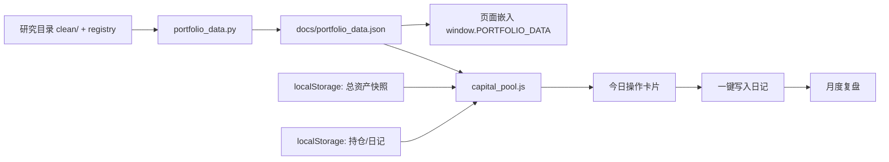

# 星循 V1.0 · 第四轮交付（二）：网站最小改造方案

> 只做方案，不改代码。第五轮经确认后才实施。
> 原则：**复用现有页面、现有日记、现有静态发布，不重写网站，不新增服务器依赖。**

---

## 1. 目标：每天回答四个问题

1. **今天需要操作吗？**（不需要就明确显示"无需操作"）
2. **买卖什么？买多少？**
3. **为什么？**（策略/配置/资金规则，逐条可查）
4. **我的总资产、资金池、持仓、现金现在是什么状态？**

---

## 2. 改造范围（只加 5 块，不改现有结构）

| # | 模块 | 放在哪 | 作用 |
|---|---|---|---|
| 1 | 总资产快照 | 现有「投资配置」页顶部 | 每月 1 日提醒；未更新沿用上次并显示日期 |
| 2 | 资金池卡片 | 同上 | 目标 10%、当前池子、允许新增、池内现金、在途 |
| 3 | 今日操作 | 同上 | 每只资产的现市值/目标/动作/金额/费用/原因 |
| 4 | 成交确认 | 现有「投资日记」页 | 从建议一键带入日记，记录实际成交与偏差 |
| 5 | 月度复盘 | 现有「投资日记」页底部 | 实际盈亏 vs 理论、资金流入 vs 投资收益 |

**不动**：

- 顶部四个导航（今日提醒 / 投资配置 / 投资日记 / 策略说明）
- 现有 ETF 监测、相关性、轮动推荐、美股溢价、行业/个股模块
- 现有 `investment_diary_v1`、`monthly_budget_v1_*`、`investment_correlations_v1` 数据结构
- 静态发布链路（GitHub Pages）与 PWA

---

## 3. 数据流



- **净值与信号**：由脚本生成 `docs/portfolio_data.json`，页面只读；不在浏览器里算策略。
- **用户资产与持仓**：仍存 `localStorage`，与现有日记一致；导出/导入沿用现有 JSON 备份。
- **金额计算**：浏览器端 `capital_pool.js`（与 Python 同逻辑），保证手机静态页离线可用。

---

## 4. 文件级改动清单

| 文件 | 类型 | 改动 | 预估 |
|---|---|---|---|
| `templates/_portfolio_v1.html` | 新增 | 5 个卡片的 HTML（总资产/资金池/今日操作/成交确认/月度复盘） | ~160 行 |
| `portfolio_store.js` | 新增 | 快照、持仓、现金流、月末估值的读写与校验 | ~140 行 |
| `capital_pool.js` | 新增 | `capital_pool.py` 的 JS 版（纯函数，无 DOM） | ~220 行 |
| `portfolio_v1.js` | 新增 | 绑定卡片、渲染、确认成交、月度复盘 | ~180 行 |
| `portfolio_data.py` | 新增 | 从 `clean/` + `strategy_registry.json` 生成 `docs/portfolio_data.json` | ~90 行 |
| `correlation_data.py` | 修改 | 在 `investment_script()` 里追加读取 `portfolio_data.json` 与 3 个 JS | +12 行 |
| `templates/_invest_tools.html` | 修改 | 在 `#invest-plan` / `#invest-diary` 内插入 include 锚点 | +2 行 |
| `templates/index.html` | 修改 | 引入 `_portfolio_v1.html` | +1 行 |
| `app.py` | 可选 | `/api/portfolio_data`（仅本地预览；静态页不需要） | +15 行 |
| `docs/` | 生成 | `portfolio_data.json`、`signals.json` | 自动 |

**总计约 800 行新代码，全部是新增文件 + 3 处单行插入；不改任何现有函数签名。**

---

## 5. 数据结构（localStorage）

### 5.1 总资产快照 `xingxun_snapshot_v1`

```json
[
  {"date": "2026-10-01", "total_assets": 20000, "confirmed_at": "2026-10-01T09:00:00+08:00", "note": ""}
]
```

- 每月 1 日显示提醒："本月尚未更新，沿用 2026-09-01 的 ¥20,000"。
- 允许随时更新；同一天只保留最后一次；历史不删除。
- 若总资产下降导致池子超过 10%，显示"暂停新增，不强制卖出"。

### 5.2 持仓与现金流 `xingxun_profile_v1`

```json
{
  "positions": [
    {"code": "000216", "name": "华安黄金ETF联接A", "shares": 116.3, "cost": 356.5, "hold_days": 120}
  ],
  "flows": [
    {"date": "2026-10-01", "type": "deposit", "amount": 500},
    {"date": "2026-10-15", "type": "withdraw", "amount": 200}
  ],
  "settings": {"ratio": 0.10, "allocation": "invvol4_cap40_v1"}
}
```

- `flows` 只记录**资金进出投资池**，不记录池内买卖；
- 池内买卖继续用现有 `investment_diary_v1`；
- 月度复盘用 `期末市值 − 期初市值 − 入金 + 出金` 计算真实投资收益。

### 5.3 建议与成交的关联

日记新增两个可选字段：

```json
{"plan_id": "2026-10-22T09:00:00+08:00|invvol4_cap40_v1", "signal_version": "hold_v1", "suggested_amount": 356.5}
```

- `plan_id` 指向当时的建议（信号日期 + 配置版本）；
- 实际金额可以与建议不同，差值在月度复盘里汇总为"执行偏差"。

---

## 6. 页面行为（逐块）

### 6.1 总资产快照

- 输入框 + "确认更新"按钮；显示"上次确认日期 / 金额 / 数据来源（手动）"。
- 若当月未更新：黄色提示条，不阻断使用，但所有金额标注"基于 YYYY-MM-DD 总资产"。
- 不允许负数、非数字；上限做 1 亿元保护。

### 6.2 资金池

```
目标额度 = 总资产 × 10%
当前池子 = 池内现金 + 持仓市值 + 在途资金
允许新增 = max(0, 目标 − 当前)
可用现金 = 池内现金 + min(允许新增, 外部现金)
```

显示：目标 / 当前 / 差额 / 池内现金 / 在途 / 持仓市值。
若当前 > 目标：红色提示"暂停新增，不强制卖出"。

### 6.3 今日操作

每行：

| 资产 | 现市值 | 目标权重 | 目标金额 | 动作 | 金额 | 费用 | 可执行 | 原因 |
|---|---|---|---|---|---|---|---|---|

- 无操作时整块显示"今天无需操作"；
- 不可执行时写明原因（暂停申购/限额/缺净值/低于 10 元/T+1 未确认）；
- 每行有"填入日记"按钮，带入代码、名称、建议金额、`plan_id`。

### 6.4 成交确认

- 预填：日期、代码、名称、动作、建议金额；
- 用户必须填写实际金额/份额/价格（可留空份额）；
- 保存到现有日记；同时更新 `positions`（买入加份额，卖出减份额）；
- 若实际金额与建议差 >10%，提示"执行偏差较大，建议在复盘里写明原因"。

### 6.5 月度复盘

- 选择月份；显示：
  - 期初市值、期末市值、入金、出金；
  - **实际投资收益 = 期末 − 期初 − 入金 + 出金**；
  - 理论收益（按信号/配置的回测日收益累乘）；
  - 买卖次数、费用、执行偏差合计；
  - 当月最大回撤（按每日估值，若有）。
- 若缺少月末估值，提示"请先记录月末持仓/市值"，不猜测。

---

## 7. 数据生成与版本

### 7.1 `portfolio_data.json`

```json
{
  "generated_at": "2026-10-22T09:00:00+08:00",
  "data_date": "2026-10-21",
  "allocation": {"id": "invvol4_cap40_v1", "method": "inverse_vol_120", "bond_cap": 0.40},
  "signals": {"000216": {"strategy": "A_hold", "version": "hold_v1", "target": 1.0}},
  "funds": {"000216": {"name": "...", "nav": 3.0672, "nav_date": "2026-10-21", "buy_pct": 0.06,
                       "redeem_tiers": [...], "status": "开放申购", "limit": null,
                       "confirm": "T+1", "settle_days": 2}},
  "cash_fund": {"code": "000198", "nav": 1.0, "yield_7d": 0.013}
}
```

规则：
- `data_date` 必须是最近一个已收盘交易日；页面显示"数据日 YYYY-MM-DD"；
- 净值缺失或过期 → 该资产不生成建议，页面显示"数据未更新"；
- 配置版本变化 → `allocation.id` 变化，旧信号文件保留。

### 7.2 信号冻结

- 每天生成 `docs/signals/YYYY-MM-DD[_vN].json`；
- 同一天不同内容 → 拒绝写入（与 `signal_journal.py` 相同规则）；
- 页面显示当前策略版本与信号日期。

---

## 8. 第五轮实施步骤（分四小步，每步可回滚）

| 步骤 | 内容 | 验收 |
|---|---|---|
| 5a | 只读展示：总资产快照 + 资金池（不计算买卖） | 数字与手算一致；刷新不丢失 |
| 5b | 今日操作（只展示，不写日记） | JS 与 Python 结果差 ≤0.01 元 |
| 5c | 成交确认 + 月度复盘 | 日记写入正确；现金流与收益分离 |
| 5d | 默认开启 + 手机端检查 | 375px 布局正常；离线可用；旧功能无回归 |

每步都保留 feature flag：`window.XINGXUN_V1 = false` 可一键隐藏新卡片。

---

## 9. 测试与验收清单（第五轮）

**金额一致性**
- [ ] 20 组 fixture：Python `plan_day` vs JS `planDay`，金额差 ≤0.01 元；
- [ ] 边界：10 元、0 现金、超池、暂停申购、限额、缺净值、7 天内赎回。

**资金安全**
- [ ] 任何路径现金不为负；
- [ ] 当日卖出款不能当日买入；
- [ ] 买入总额 ≤ 池内现金 + 本次新增。

**版本与数据**
- [ ] 同日信号不同内容被拒绝；
- [ ] 页面显示数据日与策略版本；
- [ ] 净值缺失不生成建议。

**回归**
- [ ] 今日提醒、相关性、轮动推荐、日记、导入导出全部正常；
- [ ] 静态页 `docs/index.html` 与 Flask 页显示一致；
- [ ] 手机 375px、深色模式、离线刷新。

**人工验收**
- [ ] 用 2000 元真实场景走一遍：更新总资产 → 看建议 → 记一笔成交 → 月末复盘；
- [ ] 故意填错总资产（例如 2000），确认只是暂停新增、不卖出。

---

## 10. 风险与对策

| 风险 | 对策 |
|---|---|
| JS 与 Python 金额计算分叉 | 同一套 fixtures + 每次发版跑对比测试 |
| 用户忘记更新总资产 | 每月 1 日提醒；页面始终显示数据日期；不自动推算 |
| 只存 localStorage，换设备丢失 | 保留导出/导入；后续可选服务端 JSON（不在 v1） |
| 净值过期仍显示建议 | 数据层校验 `data_date`，过期即置灰并说明原因 |
| 逆波动率债券 40% 在利率上行时拖累 | 页面展示配置说明与平均权重；每年复核一次债券上限 |
| 旧页面自动 git push 无复核 | 本轮不依赖该脚本；新数据生成脚本不自动提交 |

---

## 11. 明确不做（本轮与第五轮）

- 不自动下单、不接券商/基金交易接口；
- 不引入付费行情；
- 不重写现有页面结构；
- 不删除任何历史信号、日记、报告；
- 不把择时策略默认接入执行（C 类只显示"影子信号"）。
